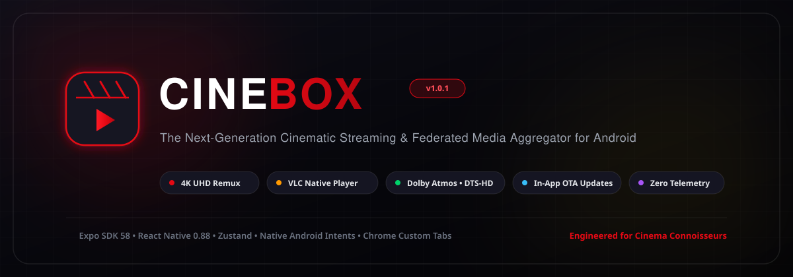
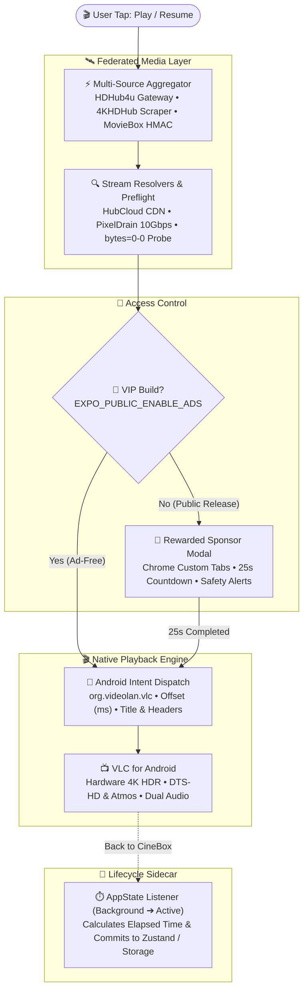

# 🎬 CineBox

> **The Next-Generation Cinematic Streaming & Federated Media Aggregator for Android**

[](https://github.com/AyushBhagat151105/CineBox/releases/latest)
[](https://github.com/AyushBhagat151105/CineBox/actions)
[](https://reactnative.dev/)
[](https://expo.dev/)
[](https://www.videolan.org/vlc/)
[](LICENSE)
[](LICENSE-APACHE)

[](https://github.com/AyushBhagat151105/CineBox/releases/latest)
[](https://cine-box-aggregator.vercel.app)
[](#-documentation-index)

---

## 📖 Table of Contents

- [Overview](#-overview)
- [Key Features](#-key-features)
- [Architecture & Data Flow](#-architecture--data-flow)
- [Codec & Audio Capability Matrix](#-codec--audio-capability-matrix)
- [Documentation Index](#-documentation-index)
- [Configuration & VIP Mode](#-configuration--vip-mode)
- [Quick Start & Development](#-quick-start)
- [CI/CD & In-App OTA Updates](#-cicd--in-app-ota-updates)
- [Legal, Privacy & Non-Hosting Disclaimer](#-legal-privacy--non-hosting-disclaimer)
- [Contributing](#-contributing)
- [Changelog](#-changelog)
- [License](#-license)

---

## 🌟 Overview

> 🌐 **Official Website**: [https://cine-box-aggregator.vercel.app](https://cine-box-aggregator.vercel.app) · **Latest Release**: [v1.1.1](https://github.com/AyushBhagat151105/CineBox/releases/latest)

**CineBox** is a high-performance Android media streaming and catalog aggregation application engineered for cinema enthusiasts who demand uncompromised playback quality.

Traditional mobile streaming clients rely on stock `ExoPlayer` or React Native video components that choke on high-bitrate **4K UHD BluRay Remuxes**, stutter on **DTS-HD Master Audio 5.1**, or drop multichannel Dolby TrueHD tracks. CineBox resolves this by pairing a **Federated Multi-Source Catalog Aggregator** with an external **Native VLC for Android Intent Bridge**, giving you full hardware decoding, gesture controls, and dual-audio language switching in a featherlight ~25 MB APK.

---

## ✨ Key Features

### 1. 🛰️ Federated Multi-Catalog Aggregation
- **HDHub4u Anti-DMCA Gateway Router**: Dynamically probes live redirect gateways (`hdhub4u.fast` ➔ fallback `h4.suncdn.org/host/`) to circumvent ISP blocking and domain takedowns.
- **4KHDHub 2160p Remux Engine**: Scrapes and indexes high-bitrate 4K UHD, HDR10, and Dolby Vision releases with embedded DTS-HD and Dolby Atmos audio tags.
- **MovieBox Cryptographic API Port**: High-speed global indexer featuring cryptographic HMAC-MD5 signing (`x-client-token`, `x-tr-signature`) and automatic host rotation across 7 API endpoints.
- **Deduplication & Preflight Probing**: Runs concurrent preflight requests (`Range: bytes=0-0`) to eliminate broken mirrors and automatically falls back to healthy CDNs.

### 2. 🎬 Native VLC for Android Media Engine
- **Hardware-Accelerated Decoders**: Offloads playback to native VLC via Android Intents (`org.videolan.vlc`), unlocking **DTS-HD MA 5.1**, **Dolby Atmos**, **TrueHD**, and **10-bit HEVC**.
- **Container Audio Track Switching**: Seamlessly toggle between Hindi, English, Tamil, Telugu, and commentary tracks directly in the native VLC interface.
- **Watch History Lifecycle Sidecar**: Automatically calculates watched duration when returning to CineBox (`AppState: background ➔ active`), updating resume timestamps and marking items as watched when exceeding 90%.
- **Universal Fallback Chooser**: If VLC is not installed, CineBox offers one-tap installation from the Google Play Store or allows using any installed media player (MPV, MX Player, Just Player).

### 3. 🚀 Over-The-Air (OTA) APK Updates
- **In-App GitHub Releases Interrogation**: Checks `api.github.com/repos/.../releases/latest` for new releases upon startup and via Settings.
- **Seamless Streaming Download**: Streams the latest APK directly to device cache with a real-time progress indicator and immediately prompts the native Android Package Installer.
- **Monotonic Version Protection**: Built-in `bump.js` tooling enforces monotonically increasing `versionCode` values (`1, 2, 3...`) to guarantee flawless in-place upgrades without data loss.

### 4. 💎 Sponsor Monetization & VIP Mode
- **Native Chrome Custom Tabs**: Solves Android `intent://` redirect crashes and black screens caused by mobile ad scripts by launching Monetag sponsor offers via `expo-web-browser`.
- **User Safety Advisories**: Prominent in-app security banners remind users that external ads are sponsor offers—no file downloads, APK installations, or browser permissions are ever required.
- **Compile-Time VIP Bypass**: Setting `EXPO_PUBLIC_ENABLE_ADS=false` permanently strips and bypasses all ad triggers for creators and private builds.

---

## 🏛️ Architecture & Data Flow



---

## 📊 Codec & Audio Capability Matrix

| Feature / Codec | Standard ExoPlayer / Web Player | CineBox + VLC Native Engine |
| :--- | :---: | :---: |
| **DTS-HD Master Audio 5.1 / 7.1** | ❌ Silent / Freeze | ✅ **Flawless Passthrough / Decode** |
| **Dolby TrueHD & Atmos** | ❌ Unsupported | ✅ **Full Hardware Acceleration** |
| **10-bit HEVC (H.265) 4K UHD** | ⚠️ High CPU / Frame Drop | ✅ **Ultra-smooth 60fps Decoded** |
| **Dolby Vision (Profile 5 & 8)** | ❌ Green / Purple Tint | ✅ **Native Tone Mapping** |
| **Multi-Language Audio Selector** | ⚠️ Unreliable | ✅ **Native VLC Audio Switcher** |
| **PGS & Styled ASS Subtitles** | ❌ Text-only SRT | ✅ **Full Bitmap & SSA Styling** |
| **Background Audio / PIP** | ⚠️ Platform Dependent | ✅ **Built-in VLC Background & PIP** |

---

## 📚 Documentation Index

Comprehensive technical documentation is maintained under the [`docs/`](docs/) directory:

- 🏛️ **[System Architecture](docs/ARCHITECTURE.md)**: Subsystem boundaries, unidirectional state flow, and persistence keys.
- 🛰️ **[Federated Providers](docs/PROVIDERS.md)**: Anti-DMCA domain probing, cryptographic HMAC request signatures, and stream resolvers.
- 🎬 **[VLC Media Engine](docs/VLC_PLAYER.md)**: Native intent specifications, lifecycle sidecar synchronization, and fallback routing.
- 💎 **[Monetization & VIP Mode](docs/MONETIZATION.md)**: Monetag Chrome Custom Tabs, countdown timer logic, and ad-free compilation.
- 🚀 **[OTA Updater & CI/CD](docs/UPDATER_AND_CICD.md)**: GitHub Releases workflow, version bump scripts, and in-app streaming installation.

---

## ⚙️ Configuration & VIP Mode

CineBox supports environment configuration via a root `.env` file:

```bash
# Copy template
cp .env.example .env
```

| Variable | Default | Purpose |
| :--- | :--- | :--- |
| `EXPO_PUBLIC_ENABLE_ADS` | `true` | Set to `false` for **Permanent VIP Mode** (completely ad-free builds). |
| `EXPO_PUBLIC_MONETAG_ZONE_ID` | `12155691` | Publisher Zone ID for Monetag SmartLinks. |
| `EXPO_PUBLIC_MONETAG_DIRECT_URL` | `https://uplcm.com/4/12155691` | Sponsor SmartLink offer URL. |

---

## 🛠️ Quick Start

### Prerequisites
- [Bun](https://bun.sh/) (v1.2+) or Node.js (v20+)
- [Android Studio & Android SDK](https://developer.android.com/studio) (API 34+)
- OpenJDK 17 (Zulu or Temurin)

### 1. Clone & Install Dependencies
```bash
git clone https://github.com/AyushBhagat151105/CineBox.git
cd CineBox
bun install
```

### 2. Verify Federated Media Providers
Run the provider integration test script to verify that upstream scrapers and resolvers are functional:
```bash
bun scripts/test_providers.ts
```

### 3. Launch Development Server
```bash
bun start
```
Press `a` to run on a connected Android device or emulator.

### 4. Build Release APK Locally
```bash
# Generates release APK for 64-bit ARM (Samsung, Pixel, OnePlus, etc.)
bun run build:apk
```
The compiled APK will be output to `./CineBox-release.apk`.

---

## 🔄 CI/CD & In-App OTA Updates

CineBox includes an automated GitHub Actions pipeline (`.github/workflows/release.yml`) that builds and attaches production APKs to GitHub Releases on tag pushes.

### Releasing an Update in 3 Commands:
```bash
# 1. Bump version and increment Android versionCode monotonically
bun run bump:patch    # e.g., v1.0.1 -> v1.0.2

# 2. Commit and tag release
git commit -am "chore(release): bump version to v1.0.2"
git tag v1.0.2

# 3. Push to trigger GitHub Actions APK build
git push origin main --tags
```
Once the cloud workflow finishes, the APK is published, and all installed CineBox clients automatically detect the update on next launch!

---

## ⚖️ Legal, Privacy & Non-Hosting Disclaimer

- **Zero-Hosting Policy**: CineBox does not host, store, stream, or distribute any media files or copyright-protected content on any servers.
- **Client-Side Indexer**: CineBox functions strictly as a client-side search aggregator and user-agent intent launcher. It indexes publicly available metadata from third-party websites across the open web.
- **Third-Party External Links**: All streaming links and sponsor offers are retrieved dynamically from external providers. The developers of CineBox hold no liability or responsibility for third-party hosting servers, advertisements, or content availability.

For comprehensive legal terms, DMCA safe harbor declarations, and data protection policies, refer to:
- ⚖️ **[Legal Disclaimer & Safe Harbor Notice](DISCLAIMER.md)**
- 🛡️ **[Privacy Policy & Zero-Telemetry Guarantee](PRIVACY_POLICY.md)**

---

## 🤝 Contributing

Contributions, bug reports, and provider enhancements are warmly welcomed! Please read our **[Contributing Guidelines](CONTRIBUTING.md)** before opening issues or pull requests.

---

## 📝 Changelog

Detailed release notes and version history are recorded in **[CHANGELOG.md](CHANGELOG.md)**.

---

## 📄 License

CineBox is open-source software dual-licensed under both the:
- **[MIT License](LICENSE)**
- **[Apache License 2.0](LICENSE-APACHE)**

You may choose to use this project under the terms of either license at your option.

---

*Crafted with precision for cinema connoisseurs worldwide.*
