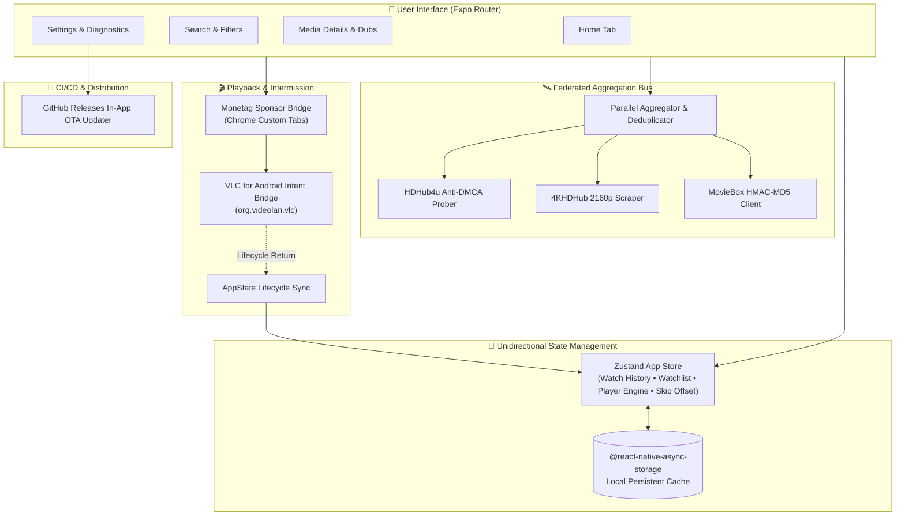

# 🏗️ CineBox System Architecture

CineBox is an open-source, high-performance mobile cinema and streaming client engineered with **Expo SDK 58**, **React Native 0.88**, **Zustand**, and **VLC for Android**.

---

## 🏛️ High-Level Component Topology

---

## 🧩 Core Subsystems

### 1. Federated Provider Aggregation Layer (`src/providers/`)
The media engine decouples catalog indexing from direct video streaming:
- **Asynchronous Parallel Search**: Every query is broadcast concurrently across all federated sources (`HDHub4u`, `4KHDHub`, `MovieBox`).
- **Deduplication Engine**: Media records with identical canonical titles and release years are unified into a single rich presentation model.
- **Probe & Failover**: When resolving media streams, CineBox conducts preflight HTTP HEAD/range requests (`bytes=0-0`) to discard broken mirrors before handoff.

### 2. External Hardware Player Bridge (`src/services/vlc.ts`)
Instead of embedding heavy C++ LibVLC libraries inside the React Native bundle, CineBox integrates with **VLC for Android** via native Android Intent (`android.intent.action.VIEW` targeting `org.videolan.vlc`):
- **Zero Audio Drops**: Direct hardware acceleration for DTS-HD Master Audio, Dolby TrueHD, AC3, EAC3, and 10-bit HEVC.
- **Lifecycle Sidecar Tracking**: Automatically detects when playback terminates and users return to CineBox (`AppState: background -> active`), calculating elapsed playtime and syncing resume marks to local storage.

### 3. Monetization & Ad Network (`src/services/ads.ts`)
- **Direct Chrome Custom Tab Routing**: Eliminates black screens and Android intent redirection bugs (`intent://`) caused by mobile ad scripts by launching offers via `expo-web-browser`.
- **User Safety Guardrails**: Displays clear security warnings informing users that ads are third-party sponsor offers requiring zero downloads or permissions.

### 4. Over-The-Air (OTA) Release Updater (`src/services/updater.ts`)
- **Direct GitHub Releases Interrogation**: Checks `api.github.com/repos/AyushBhagat151105/CineBox/releases/latest`.
- **SemVer Comparison & Progress Tracking**: Compares SemVer against the local build. If an update is available, streams the release APK directly to the app's cache directory and triggers the native package installer intent.

---

## 💾 Persistence & Storage Model

All persistent data is stored offline on the user's device using `@react-native-async-storage/async-storage`:

| Key | Purpose | Format |
| :--- | :--- | :--- |
| `@cinebox_watch_history` | Playback timestamps, total duration, completion percentage | JSON Array of `WatchProgress` |
| `@cinebox_favorites` | Bookmarked movies and television series | JSON Array of `MediaItem` |
| `@cinebox_preferred_player`| Player preference (`vlc` vs `chooser`) | String (`'vlc'` \| `'chooser'`) |
| `@cinebox_skip_seconds` | Double-tap skip duration (5s, 10s, 15s, 30s) | Number |
