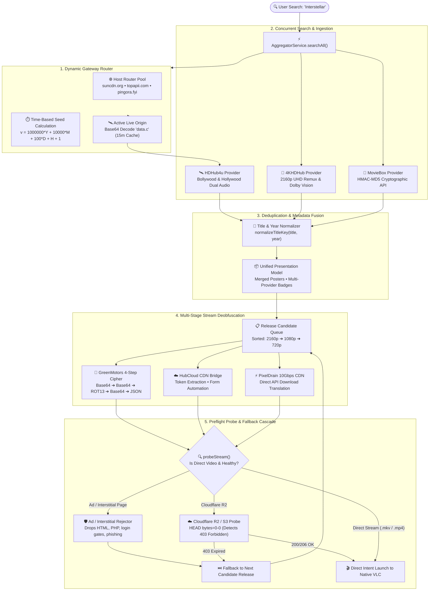

# 🛰️ Federated Media Aggregator & Stream Resolution Engine

CineBox implements a decentralized, fault-tolerant **Federated Media Aggregator** that decouples catalog ingestion from direct video playback. Instead of relying on a single brittle backend, CineBox federates multiple independent scrapers, bypasses multi-stage obfuscation gates, verifies stream reachability via preflight range probing, and seamlessly cascades across fallback mirrors.

---

## 🏛️ System Architecture



---

### 🖥️ Terminal Flow Diagram

```text
 ╔══════════════════════════════════════════════════════════════════════════════════════════════╗
 ║                              CINEBOX FEDERATED AGGREGATOR                                    ║
 ╚══════════════════════════════════════════════════════════════════════════════════════════════╝
                                                │
                                                ▼ [ User Search Query ]
 ┌──────────────────────────────────────────────────────────────────────────────────────────────┐
 │ 1. DYNAMIC GATEWAY ROUTER (Anti-DMCA Domain Discovery)                                       │
 │    • Probes: suncdn.org/host/, points.topapii.com/host/, dns.pingora.fyi/v2/host             │
 │    • Time-Seed: v = 1000000*Y + 10000*M + 100*D + H + 1                                     │
 │    • Unpacks Base64 payload (data.c) ──► Resolves live origin (e.g. https://new10.hdhub4u.cl)│
 └──────────────────────────────────────┬───────────────────────────────────────────────────────┘
                                        │
                                        ▼
 ┌──────────────────────────────────────────────────────────────────────────────────────────────┐
 │ 2. PARALLEL CONCURRENT HARVESTING                                                            │
 │    Promise.all([                                                                             │
 │      HDHub4uProvider.search("Oppenheimer"),      // Bollywood / Hollywood Dual Audio         │
 │      FourKHdHubProvider.search("Oppenheimer"),   // 4K UHD Remux, Dolby Vision, DTS-HD       │
 │      MovieBoxProvider.search("Oppenheimer")      // Cryptographic HMAC API Indexer           │
 │    ])                                                                                        │
 └──────────────────────────────────────┬───────────────────────────────────────────────────────┘
                                        │
                                        ▼
 ┌──────────────────────────────────────────────────────────────────────────────────────────────┐
 │ 3. DEDUPLICATION & PRESENTATION FUSION                                                       │
 │    • Normalize key: title.toLowerCase().replace(/[^a-z0-9]/g, '') + "_" + year               │
 │    • Merges duplicate entries into 1 unified card with badges: ['hdhub4u', 'fourkhdhub']     │
 │    • Combines highest resolution posters, ratings, and plot summaries                        │
 └──────────────────────────────────────┬───────────────────────────────────────────────────────┘
                                        │
                                        ▼ [ User Taps "Play" / "Select Stream" ]
 ┌──────────────────────────────────────────────────────────────────────────────────────────────┐
 │ 4. QUALITY-SORTED RELEASE CASCADE                                                            │
 │    Candidate 1: 4K UHD (2160p) Remux • DTS-HD MA 5.1 • 28.4 GB                               │
 │    Candidate 2: 1080p BluRay • Dolby Atmos • 6.2 GB                                          │
 │    Candidate 3: 720p WebRip • AAC 2.0 • 1.4 GB                                               │
 └──────────────────────────────────────┬───────────────────────────────────────────────────────┘
                                        │
                                        ▼
 ┌──────────────────────────────────────────────────────────────────────────────────────────────┐
 │ 5. DEOBFUSCATION & RESOLVER PIPELINE                                                         │
 │    • GreenMotors 4-Step Cipher: Base64 ➔ Base64 ➔ ROT13 ➔ Base64 ➔ JSON ➔ Base64(o)          │
 │    • HubCloud CDN: Automated form submission, token extraction, and stream link extraction   │
 │    • PixelDrain: Translates file locker page to 10Gbps direct API endpoint                   │
 └──────────────────────────────────────┬───────────────────────────────────────────────────────┘
                                        │
                                        ▼
 ┌──────────────────────────────────────────────────────────────────────────────────────────────┐
 │ 6. PRE-FLIGHT VALIDATION & ACTIVE RANGE PROBE                                                │
 │    • Rejects intermediate landing pages (cryptonewz, snvhost, login.php, .html)              │
 │    • Probes Cloudflare R2 / S3 URLs with HTTP HEAD (Range: bytes=0-0)                         │
 │    • 200/206 OK  ──► Validated stream handed to VLC Intent                                  │
 │    • 403/404 ERR ──► Automatically discards candidate & falls back to next release in queue  │
 └──────────────────────────────────────────────────────────────────────────────────────────────┘
```

---

## 🧩 Deep-Dive: Core Subsystems

### 1. Dynamic Anti-DMCA Gateway Discovery (`src/providers/hdhub4u/domain.ts`)

Because free streaming indexing domains are subject to frequent ISP DNS poisoning and DMCA domain seizures, CineBox avoids hardcoding static endpoints. Instead, it utilizes an automated host router pool:

```typescript
const ROUTER_HOSTS = [
  'https://h4.suncdn.org/host/',
  'https://points.topapii.com/host/',
  'https://ml.theapii.org/host/',
  'https://dns.pingora.fyi/v2/host',
  'https://cdn.hub4u.cloud/host/',
];
```

#### The Time-Seed Formula
To prevent upstream cache caching and ensure coordinated domain updates with the website's gateway:
```typescript
const d = new Date();
const v =
  1000000 * d.getUTCFullYear() +
  10000 * (d.getUTCMonth() + 1) +
  100 * d.getUTCDate() +
  d.getUTCHours() +
  1;
```
The router endpoint returns a JSON payload containing an encrypted string `data.c`:
1. CineBox decodes the Base64 ciphertext: `decodeBase64(data.c)` ➔ `https://new10.hdhub4u.cl/?utm=mn1`.
2. The URL origin is parsed: `new URL(decoded).origin` ➔ `https://new10.hdhub4u.cl`.
3. The active domain is cached in memory with a **15-minute TTL** (`PROBE_TTL = 15 * 60 * 1000`).

---

### 2. Federated Search & Deduplication Engine (`src/providers/aggregator.ts`)

When a user searches for a movie or TV show, queries are broadcast concurrently across all registered providers using `Promise.all`:

```typescript
const searchPromises = Array.from(this.providers.values()).map(async (p) => {
  try {
    return await p.search(query);
  } catch (err) {
    console.warn(`[Aggregator] Provider ${p.name} search failed:`, err);
    return [];
  }
});
```

#### Deduplication & Identity Normalization
Multiple providers often index the exact same film with slight differences in capitalization, punctuation, or regional formatting:
- *Provider A*: `"Dune: Part Two (2024) [Dual Audio] [Hindi + Eng]"`
- *Provider B*: `"Dune Part 2 2024 2160p UHD Remux"`

The aggregator normalizes both titles to a canonical dictionary key:
```typescript
private normalizeTitleKey(title: string, year?: number): string {
  const cleanTitle = title
    .toLowerCase()
    .replace(/[^a-z0-9]/g, '')
    .trim();
  return `${cleanTitle}_${year || ''}`;
}
```
If two items match the normalized key:
- They are merged into a single `CatalogItem`.
- Their provider IDs are combined into `availableProviders: ['hdhub4u', 'fourkhdhub']`.
- The highest quality poster artwork and description are preserved.

---

### 3. Deobfuscation & Cipher Unpacking (`src/providers/hdhub4u/resolver.ts`)

Many file hosts wrap their direct CDN stream URLs behind multi-stage JavaScript obfuscators and ad-shorteners. CineBox includes native decryptors to unpack these payloads on the client without opening ad redirects:

#### GreenMotors 4-Step Cipher Unpacker
GreenMotors wraps stream endpoints in nested layers of Base64 and ROT13 substitutions:
```text
Raw Payload ➔ Base64 Decode ➔ Base64 Decode ➔ ROT13 Decrypt ➔ Base64 Decode ➔ JSON.parse() ➔ Base64 Decode (json.o) ➔ Direct CDN URL
```

Implementation:
```typescript
function rot13(str: string): string {
  return str.replace(/[a-zA-Z]/g, (c) => {
    const base = c <= 'Z' ? 65 : 97;
    return String.fromCharCode(((c.charCodeAt(0) - base + 13) % 26) + base);
  });
}

export function decodeGreenmotorsPayload(payload: string): string | null {
  const s1 = decodeBase64(payload);
  const s2 = decodeBase64(s1);
  const s3 = rot13(s2);
  const s4 = decodeBase64(s3);
  const json = JSON.parse(s4);
  if (json && json.o) {
    const target = decodeBase64(json.o);
    return target.startsWith('http') ? target : null;
  }
  return null;
}
```

#### HubCloud Token & Form Automation
1. CineBox issues an HTTP request to the HubCloud file link.
2. Extracts hidden anti-bot form tokens (`_token`, `time`, `action`).
3. Sends an automated form POST to simulate the user clicking "Generate Download Link".
4. Parses the resulting HTML with `node-html-parser` to extract the high-speed CDN endpoint.

#### PixelDrain 10Gbps Direct Resolver
PixelDrain URLs (`https://pixeldrain.com/u/{id}`) require transformation into direct streaming endpoints with user-agent headers:
```typescript
const directUrl = `https://pixeldrain.com/api/file/${fileId}?download`;
```

---

### 4. Intelligent Preflight Validation & Fallback Queue (`probeStream`)

A major flaw in traditional streaming apps is attempting to play dead links, expired presigned tokens, or interstitial landing pages, resulting in black screens or endless spinners in the video player.

CineBox implements an active **Pre-flight Probe** before triggering the native VLC player:

#### 1. Blacklist Interstitial & Phishing Landing Pages
Rejects ad networks, URL shorteners, and fake login gates immediately without making outbound network requests:
```typescript
if (
  lower.includes('cryptonewz.online') ||
  lower.includes('snvhost.com') ||
  lower.includes('greenmotors.') ||
  lower.includes('login.php') ||
  lower.endsWith('.html') ||
  lower.endsWith('.php')
) {
  return false;
}
```

#### 2. Cloudflare R2 & S3 Expired Token Detection
Cloudflare R2 storage URLs often have expiring HMAC credentials. If an account is suspended or a link expired, S3 returns `403 Forbidden`:
```typescript
if (lower.includes('cloudflarestorage.com') || lower.includes('.r2.dev')) {
  const probeRes = await axios.head(url, {
    headers: { 'User-Agent': BROWSER_UA, ...(headers || {}) },
    timeout: 2500,
    validateStatus: (s) => s >= 200 && s < 400,
  });
  return probeRes.status >= 200 && probeRes.status < 400;
}
```

#### 3. Seamless Auto-Fallback Cascade (`resolveWithFallback`)
When a user requests playback:
1. Releases are sorted by resolution: `2160p (4K UHD)` ➔ `1080p` ➔ `720p` ➔ `480p`.
2. The Aggregator attempts Candidate 1:
   - Resolves stream link.
   - Runs `probeStream()`.
   - If healthy ➔ Dispatches Android Intent to VLC! 🎬
3. If Candidate 1 fails (403 expired, broken server, or bad redirect):
   - Immediately logs warning and advances to Candidate 2 without user intervention.
   - Repeats down the queue until a verified, working stream is handed to the native player.

---

## 📊 Provider Capability Comparison Matrix

| Feature | HDHub4u | 4KHDHub | MovieBox API |
| :--- | :---: | :---: | :---: |
| **Primary Focus** | Bollywood, South Hindi Dubbed, Hollywood | 4K UHD, HDR10+, Dolby Vision Remuxes | Global Cinema, TV Series, Multilingual Dubs |
| **Max Resolution** | 1080p FHD | **2160p (4K UHD)** | 1080p FHD |
| **Multichannel Audio** | 5.1 Dolby Digital Plus | **DTS-HD MA 7.1 / Dolby Atmos** | Stereo / 5.1 Surround |
| **Domain Resilience** | Active Dynamic Gateway Router | Static Mirror Scrubbing | Dynamic Endpoint Host Rotation |
| **Authentication** | None (HTML Scraper) | None (HTML Scraper) | **HMAC-MD5 Cryptographic Signatures** |
| **Resolvers Supported** | HubCloud, PixelDrain, GDrive | Fast Cloudflare R2, PixelDrain, 10Gbps CDN | Direct MP4 / HLS Streams |
| **Preflight Probing** | Range GET / HEAD validation | S3/R2 Token Verification | Content-Length & Header Probing |

---

## 🛠️ Testing the Aggregator Locally

You can test upstream scrapers, domain discovery, and stream resolvers from the command line:

```bash
bun scripts/test_providers.ts
```

This script queries active gateway endpoints, resolves candidate releases, runs preflight verification, and logs latency and status codes directly to the terminal.
