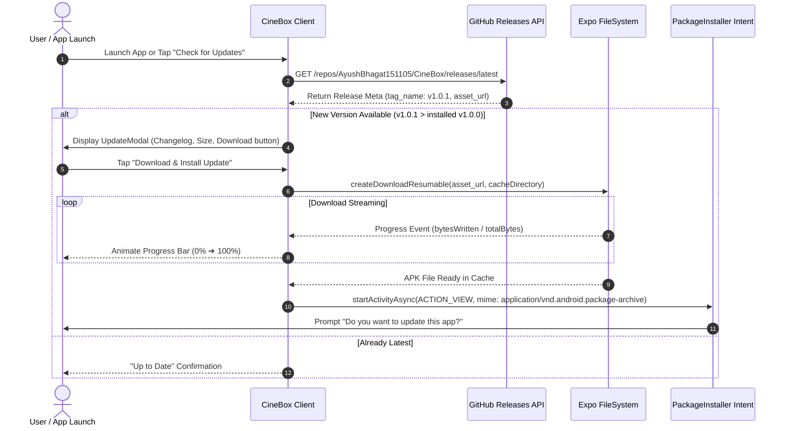

# 🚀 Over-The-Air (OTA) Updater & CI/CD Pipeline

CineBox includes an integrated In-App Over-The-Air (OTA) APK Updater and an automated GitHub Actions CI/CD release pipeline.

---

## 📲 In-App OTA Updater Architecture (`src/services/updater.ts`)



### Monotonic Versioning
Android strictly forbids installing an APK over an existing installation if the `versionCode` is lower than or equal to the current one.
- `versionCode` (Integer): Incremented on every single build (`1`, `2`, `3`, ...).
- `versionName` (String): Follows Semantic Versioning (`1.0.0`, `1.0.1`, `1.1.0`).

### Automated Version Bump Script (`scripts/bump.js`)
To prevent mismatched version strings, run:
```bash
bun run bump:patch   # e.g., 1.0.1 -> 1.0.2 (versionCode: 2 -> 3)
bun run bump:minor   # e.g., 1.0.1 -> 1.1.0 (versionCode: 2 -> 3)
bun run bump:major   # e.g., 1.0.1 -> 2.0.0 (versionCode: 2 -> 3)
```
This synchronously updates:
1. `package.json` (`version`)
2. `app.json` (`expo.version`, `expo.android.versionCode`)
3. `android/app/build.gradle` (`versionCode`, `versionName`)

---

## ⚙️ GitHub Actions CI/CD Workflow (`.github/workflows/release.yml`)

The release pipeline triggers whenever a new Git tag matching `v*` is pushed:

```bash
git tag v1.0.1
git push origin v1.0.1
```

### Pipeline Steps:
1. **Runner Environment**: Spins up `ubuntu-latest`.
2. **Runtime Toolchains**:
   - `actions/setup-node@v4` (Node 20)
   - `oven-sh/setup-bun@v2` (Latest Bun)
   - `actions/setup-java@v4` (Zulu OpenJDK 17)
   - `android-actions/setup-android@v3` with `packages: 'platform-tools'` (Android SDK)
3. **Dependency Installation**: `bun install --frozen-lockfile`.
4. **Compilation**:
   ```bash
   cd android && ./gradlew assembleRelease -PreactNativeArchitectures=arm64-v8a,armeabi-v7a
   ```
5. **Asset Staging**: Copies `app-release.apk` to `output/CineBox-${TAG_NAME}.apk`.
6. **Publishing**: Uses `softprops/action-gh-release@v2` with `secrets.GITHUB_TOKEN` to generate release notes and publish the APK asset to GitHub Releases.
